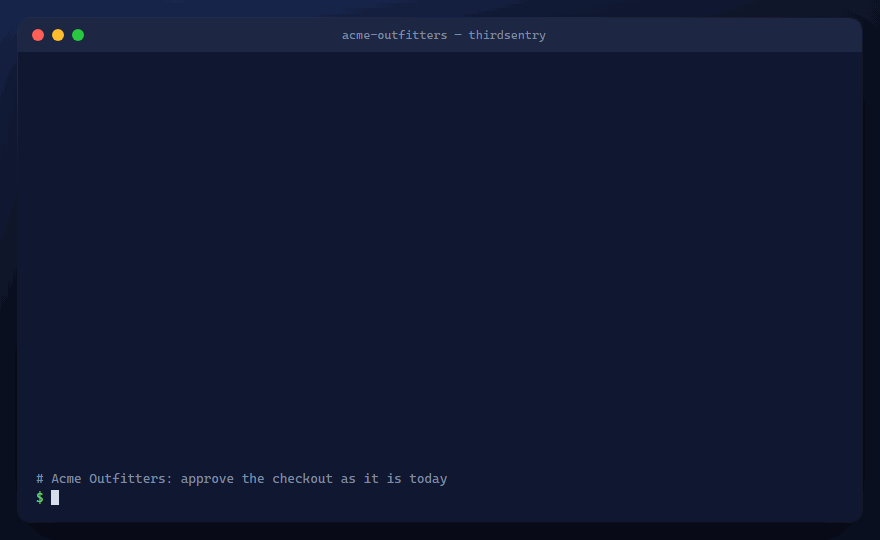
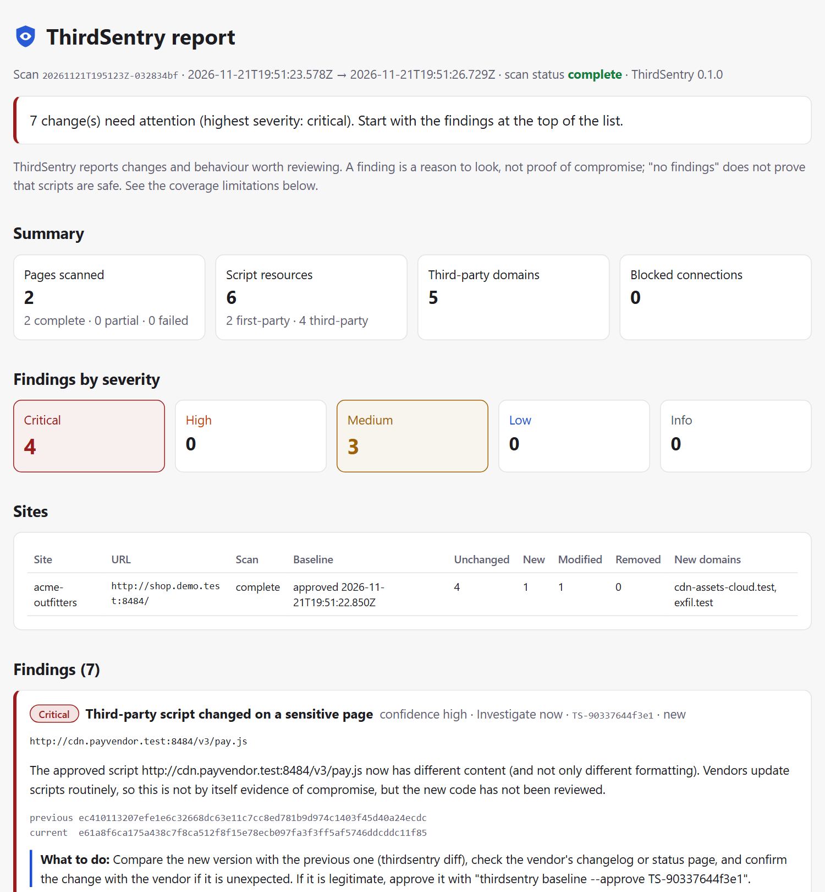
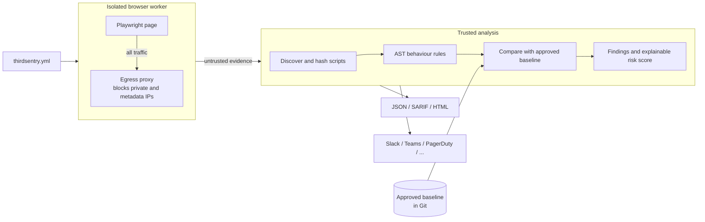

<div align="center">


# ThirdSentry

**Watch the code you don't control.**

Open-source, self-hosted monitoring for the third-party JavaScript on your website.<br>
It catches Magecart-style skimmers, tampered vendor scripts and checkout changes before your customers do.

[](https://github.com/NikhilBidhuri/ThirdSentry/actions/workflows/ci.yml)
[](LICENSE)
[](docs/installation.md)
[](docs/architecture.md)
[](docs/pci.md)
[](CONTRIBUTING.md)

[**Try the demo**](#-try-it-in-60-seconds) · [**Sample report**](#-the-report) · [**Quick start**](#-quick-start) · [**Docs**](#-documentation)

<br>



<sub>A real run of <code>npm run demo</code>: approve a clean checkout, compromise a vendor script, scan again.</sub>

</div>

---

## Why

Your checkout page runs code from analytics vendors, tag managers, payment SDKs, chat widgets and A/B tools. **You don't review that code, and it can change at any time.** Your own repository stays the same, but your customers start running different code. That is how these incidents happened:

- **British Airways (2018):** a modified script on the payment page skimmed card data for two weeks.
- **Ticketmaster (2018):** a compromised third-party chatbot script ran on payment pages.
- **polyfill.io (2024):** a widely used CDN domain changed hands and started serving malicious code to more than 100,000 sites.
- **Optimizely (2026):** A/B-testing snippets on 178 organisations' sites, including the BBC, CNN and Zoom, served a wallet swapper and card skimmer from the vendor's own CDN URL. [How ThirdSentry handles it →](#-case-study-the-optimizely-snippet-hijack-november-2026)

ThirdSentry opens your pages in a **real browser**, records **every script that runs**, hashes it, analyses what it does, and compares the result with a **baseline you approved**. When something changes, it explains what changed, where, how risky the change looks and what to do next.

| | CSP alone | SRI alone | **ThirdSentry** |
| --- | :-: | :-: | :-: |
| Notices that an allowed vendor's script **content** changed | ❌ | ✅ for pinned files only, and breaks on every legitimate update | ✅ |
| Shows **what the new code does** (reads card fields, beacons, `eval`, obfuscation) | ❌ | ❌ | ✅ |
| Covers **runtime-injected** scripts, iframes, workers, `blob:` scripts | partly | ❌ | ✅ |
| Detects checkout **form tampering** and **weakened security headers** | ❌ | ❌ | ✅ |
| Gives you an audit trail for **PCI DSS 6.4.3 / 11.6.1** | ❌ | ❌ | ✅ |

> ThirdSentry is a **monitoring and detection** tool. It does not block or remove malicious code, it cannot prove that code is safe, and it does not by itself make you PCI DSS compliant. It gives you evidence and early warning so that people can investigate. It works well **alongside** CSP and SRI.

## 🚀 Try it in 60 seconds

The demo runs a small local shop, "Acme Outfitters", on fake `.test` hostnames on `127.0.0.1`. It approves the clean checkout, then simulates a Magecart-style compromise and scans again. Nothing leaves your machine.

```bash
git clone https://github.com/NikhilBidhuri/ThirdSentry.git && cd ThirdSentry
npm ci && npx playwright install chromium
npm run demo -- --open          # --open shows the HTML report in your browser when done
npm run demo -- --scenario snippet-hijack   # the Optimizely-style attack (see below)
```

<details>
<summary><b>What does the simulated attack do, and what catches it?</b></summary>

<br>

| # | Attack (real-world pattern) | ThirdSentry finding | Severity |
| - | --- | --- | :-: |
| 1 | Card skimmer appended to the payment vendor's `pay.js` (supply-chain compromise) | `resource-modified` + new behaviour `TS-SENSITIVE-FIELD-ACCESS`, `TS-EXFIL-COMBINATION` | 🔴 critical |
| 2 | Obfuscated loader from the lookalike domain `cdn-assets-cloud.test` runs `eval` (polyfill.io style) | `resource-added` + `TS-OBFUSCATION`, `TS-EVAL`; `new-script-domain` | 🔴 critical |
| 3 | Stolen data beaconed to `collect.exfil.test` | `new-outbound-domain` | 🟡 medium |
| 4 | Checkout form re-targeted to the attacker, with an extra "card PIN" field | `payment-form-changed` (PCI DSS 11.6.1) | 🔴 critical |
| 5 | `Content-Security-Policy` and `X-Frame-Options` removed from `/checkout` | `security-header-changed` | 🔴 critical |

The analytics tag and first-party code don't change, so they aren't flagged. The scan exits with code `1`, which fails a CI job. See [demo/README.md](demo/README.md) for more.

</details>

## 🔍 Case study: the Optimizely snippet hijack (November 2026)

On 16 November 2026, an attacker abused a vulnerability in Optimizely Web Experimentation to add JavaScript to customers' **project JavaScript**. The snippet kept its trusted URL on `cdn.optimizely.com`; only its content changed. For about 17 hours, [188 snippets across 178 organisations](https://blog.report-uri.com/worlds-largest-brands-infected-with-malware-via-optimizely/), including the BBC, CNN and Zoom, loaded a payload from an attacker domain that:
- swapped crypto wallet addresses;
- skimmed card fields;
- sent cookies off the page;
- targeted iPhones with exploit kits.

Allow-lists based on URLs couldn't see this, because the script still came from the vendor everyone had allowed.

`npm run demo -- --scenario snippet-hijack` reproduces the pattern harmlessly. The shop's A/B-testing snippet keeps its URL, but its project JavaScript now does two things:
- builds a script URL from base64 and loads `track.js` from `c2.attacker.test`, with an `eval` fallback if the script is blocked;
- through `track.js`, swaps wallet addresses on copy and in `fetch`/XHR requests, skims card fields and beacons the data out.

This is what the next scheduled scan reports:

| Signal | ThirdSentry finding | Severity |
| --- | --- | :-: |
| The payload: clipboard access, `fetch`/XHR overrides, payment-field access, data transmission | `resource-added` + `TS-CLIPBOARD`, `TS-NETWORK-API-HOOK`, `TS-SENSITIVE-FIELD-ACCESS`, `TS-EXFIL-COMBINATION` | 🔴 critical |
| The vendor snippet: same URL, different content, new `eval` and script injection | `resource-modified` + `TS-EVAL`, `TS-SCRIPT-INJECTION` | 🔴 critical |
| The page now sends data to `c2.attacker.test` | `new-outbound-domain` | 🟠 high |
| Scripts load from a domain never approved for the site | `new-script-domain` | 🟡 medium |

[`tests/integration/demo.test.ts`](tests/integration/demo.test.ts) checks these findings on every CI run.

**What this means in practice:**
- **It detects the hijack; it does not prevent it.** Visitors are exposed until the next scan. With the 6-hour schedule in the example workflow, a 17-hour incident would have been flagged within 6 hours. Scan checkout pages more often to shrink that window.
- **The theft itself happens on form submit**, which ThirdSentry never does on payment forms. It flags the changed snippet, the injected script and its behaviour, and the new destination instead.
- **A strict CSP is what blocks the payload.** In the demo, the checkout page's `script-src` stops `track.js` from loading (the scan shows it as `unavailable`), while the home page, which has no CSP, runs it. Report-uri saw the same thing, and also saw the `eval` fallback run where `'unsafe-eval'` was allowed. Use `thirdsentry csp-lint` to tighten your policy; ThirdSentry then flags it if the policy is later weakened or removed.
- **Experimentation snippets change legitimately** whenever someone edits an experiment. Use a [`path-versions` script policy](docs/policies.md) to accept routine updates; new behaviour and new destinations are still reported at full severity.

## 📊 The report

Every scan writes **JSON**, **SARIF** (for GitHub Code Scanning) and a self-contained **HTML** report. The HTML report contains no scripts and loads nothing from the network, so it is safe to open.

<div align="center">
<a href="https://htmlpreview.github.io/?https://github.com/NikhilBidhuri/ThirdSentry/blob/main/docs/assets/sample-report.html"></a>

<sub><a href="https://htmlpreview.github.io/?https://github.com/NikhilBidhuri/ThirdSentry/blob/main/docs/assets/sample-report.html">Open the full sample report</a> (or download <a href="docs/assets/sample-report.html"><code>docs/assets/sample-report.html</code></a> and open it locally)</sub>
</div>

Each finding explains itself: what changed, a severity and confidence, **why it scored that way** (for example `+25 content of an approved third-party script changed`, `+22 accesses payment or password fields`), and a concrete next step, including the exact command to approve the change if it turns out to be legitimate.

## ✨ Features

| | |
| --- | --- |
| 🌐 **Real-browser scanning** | Playwright with Chromium, Firefox, WebKit and mobile emulation. [Logged-in journeys](docs/configuration.md) (login → cart → checkout), with a guard against submitting payment forms. |
| 🔎 **Sees all executable code** | External and inline scripts, ES modules and `import()`, runtime-injected scripts, iframes, web/shared/service workers, `blob:`/`data:` scripts and WebAssembly. |
| #️⃣ **Hashes everything** | SHA-256 of the exact bytes, an SRI value, and a normalised hash that separates formatting-only changes from code changes. |
| ✅ **Approved baselines** | Git-friendly JSON with an audit trail. [Scans never approve anything automatically.](docs/baselines.md) |
| 🧠 **Behaviour analysis** | [Babel AST rules](docs/rules.md) for `eval`, script injection, cookie/storage/form access, beacons, WebSockets, obfuscation and "sensitive data + transmission" combinations. Every score is explained. |
| 🔁 **Rotating vendor scripts** | [Script policies](docs/policies.md) (pin, path-versions, domain-only) that are explicit, expiring and reviewable, and never hide new suspicious behaviour. |
| 📚 **Libraries and CVEs** | Recognises jQuery, Lodash, Bootstrap and other libraries offline, and flags [known vulnerabilities](docs/libraries.md) from the retire.js database. |
| 💳 **PCI DSS v4.0** | A 6.4.3 script inventory (`thirdsentry inventory`), plus 11.6.1 detection of payment-form and security-header changes. [Docs](docs/pci.md). |
| 🔔 **Alerts** | Slack, Microsoft Teams, PagerDuty, webhooks, GitHub Issues and email. Also a [heartbeat and Prometheus metrics](docs/monitoring.md). |
| 🛡️ **CSP linter** | `thirdsentry csp-lint` analyses your Content-Security-Policy. [Docs](docs/csp.md). |
| 🔒 **Hardened by design** | The browser is treated as hostile. All its traffic goes through an egress proxy that blocks private, loopback and cloud-metadata addresses on every connection, and the browser runs in a separate process or container with no access to your secrets. [Security model](docs/security.md). |

## ⚡ Quick start

Requirements: Node.js 20.11 or newer.

```bash
npm install --save-dev thirdsentry
npx playwright install chromium        # browser used for scanning

npx thirdsentry init --url https://www.example.com --name my-store
# edit thirdsentry.yml: add the pages you care about (e.g. /checkout)

npx thirdsentry scan                   # see which scripts your pages load
npx thirdsentry baseline               # review, then approve the current state
npx thirdsentry scan --fail-on high    # later: detect drift; non-zero exit on findings
npx thirdsentry diff                   # review findings (and code diffs, if content retention is on)
npx thirdsentry baseline --approve <finding-id>   # approve a reviewed change
npx thirdsentry csp-lint https://www.example.com  # analyse your Content-Security-Policy
```

## 🤖 Run it on a schedule

**GitHub Actions:** scan every few hours, upload SARIF to Code Scanning, and fail or alert on high-severity changes. See the full workflow in [`examples/github-workflow.yml`](examples/github-workflow.yml).

```yaml
on:
  schedule:
    - cron: '17 */6 * * *'
jobs:
  scan:
    runs-on: ubuntu-24.04
    permissions: { contents: read, security-events: write }
    steps:
      - uses: actions/checkout@v4
      - uses: actions/setup-node@v4
        with: { node-version: 22 }
      - uses: <owner>/thirdsentry@<ref>   # pin a tag or commit SHA
        with: { fail-on: high }
```

**Self-hosted:** use [Docker Compose](docs/docker.md), with the browser, analyser and alerter in separate containers and no network access for the analyser, or [cron/systemd](docs/cron.md).

## 🧩 How it works



Untrusted evidence comes from an isolated browser worker. Trusted code turns it into findings and never executes it. See [docs/architecture.md](docs/architecture.md).

## 📖 Documentation

| Topic | |
| --- | --- |
| [Installation](docs/installation.md) | npm, Docker, browsers |
| [Configuration](docs/configuration.md) | every `thirdsentry.yml` option |
| [CLI reference](docs/cli.md) | commands, flags and exit codes |
| [Baselines](docs/baselines.md) | approving and updating what is expected |
| [Script policies](docs/policies.md) | pin / path-versions / domain-only for rotating vendor scripts |
| [Detection rules](docs/rules.md) | static-analysis rules and risk scoring |
| [Libraries and CVEs](docs/libraries.md) | library detection and the vulnerability database |
| [Alerts](docs/alerts.md) | Slack, Teams, PagerDuty, webhook, GitHub Issues, email |
| [GitHub Actions](docs/github-actions.md) | scheduled scans in CI |
| [Docker](docs/docker.md) and [cron](docs/cron.md) | self-hosted scheduled scans |
| [Health and monitoring](docs/monitoring.md) | failed-scan alerts, heartbeat (dead-man's switch), Prometheus metrics, `status` |
| [CSP analysis](docs/csp.md) | `thirdsentry csp-lint` |
| [PCI DSS support](docs/pci.md) | script inventory (6.4.3), header and payment-form change detection (11.6.1) |
| [Security model](docs/security.md) | threat model and isolation boundaries |
| [Privacy and data retention](docs/privacy.md) | exactly what is collected and stored |
| [Known limitations](docs/limitations.md) | what ThirdSentry cannot see |
| [Architecture](docs/architecture.md) | how the pieces fit together |
| [Troubleshooting](docs/troubleshooting.md) | common problems |

## 🤝 Contributing

Contributions are welcome, from new detection rules to docs fixes. Good places to start:

- **Add or tune a detection rule** in [`src/analysis/indicator-rules.ts`](src/analysis/indicator-rules.ts). Each rule has positive and negative tests ([guide](CONTRIBUTING.md#adding-a-detection-rule)).
- **Extend the demo attack** in [`demo/site/server.mjs`](demo/site/server.mjs). [`tests/integration/demo.test.ts`](tests/integration/demo.test.ts) checks that every simulated attack is caught.
- **Improve the docs**, especially if something confused you when you tried ThirdSentry.

Read [CONTRIBUTING.md](CONTRIBUTING.md) for setup and ground rules. Report vulnerabilities privately as described in [SECURITY.md](SECURITY.md).

## Project status

ThirdSentry is a young project. The scanner, baselines, change detection, static analysis, reports, alerts, CSP linter, Docker pipeline and GitHub Action are implemented. They are covered by automated tests that run against local fixture servers. The alert integrations are tested against local mock servers, not against live Slack, GitHub or SMTP services. The GitHub Action is not exercised by this repository's test suite. See [docs/limitations.md](docs/limitations.md) for an honest list of what ThirdSentry does not cover.

## License

Apache License 2.0. See [LICENSE](LICENSE).
